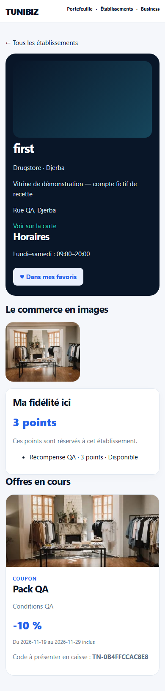
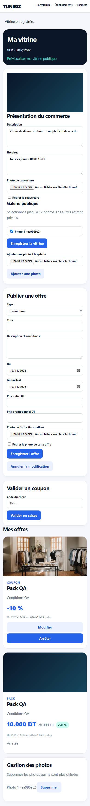

# TUNIBIZ V0.5.0 Pilot — état vérifié au 19 novembre 2026

**Décision actuelle : NO-GO pour annoncer une version commerciale entièrement validée.**
Les corrections décrites ci-dessous sont développées et testées localement. Aucun Reload PythonAnywhere, aucune publication d'APK, aucune modification des comptes réels Makhzen Djerbi ou Z Drugstore n'ont été effectués pendant cette mission. La branche de travail est `pilot/v0.5.0-20261119`, issue de `f4c87ac`.

## Corrections de sécurité

| Priorité | Constat | Correction | Validation |
|---|---|---|---|
| P1 | Supprimer puis recréer un compte avec le même email redonnait 3 points | Empreinte HMAC par email/commerce conservée 90 jours, indépendante du compte supprimé | Régression suppression/recréation : nouveau bonus = 0 |
| P1 | Un email non confirmé pouvait rejoindre un commerce | Lien email haché, 20 minutes, usage unique ; vérification exigée par défaut en production avant scan | Fournisseur simulé : refus avant confirmation, succès ensuite, rejeu refusé |
| P1 | Autorisation commerçant vérifiée avant la transaction d'écriture | Nouvelle vérification session + abonnement sous verrou SQLite dans les mutations CRM, Nearby, vitrine et catalogue | Révocation injectée entre premier contrôle et écriture : 401 |
| P1 | Clés de déduplication partagées entre commerçants et opérations système | Noms distincts par commerce et type ; migration des anciennes clés manuelles | Même référence acceptée dans deux commerces, répétition identique dédupliquée |
| P1 | SQLite additionnait `'welcome:' + id` au lieu de concaténer | Concaténation `||` pour les nouveaux bonus | Régression d'attribution et isolation |
| P1 | Dépendances installées anciennes avec avis OSV | Environnement de validation isolé corrigé, bornes actualisées et `requirements.lock` | 21 paquets de production interrogés : aucun avis OSV retourné à cette date |
| P1 | Workflow historique pouvant publier un APK debug | Workflow limité à l'analyse et aux tests, permission GitHub lecture seule | Revue du workflow |
| P1 | Pas de journal des changements administratifs | Journal écrit dans la même transaction que chaque modification | Échec d'insertion du journal injecté : modification annulée |
| P1 | Conditions d'un coupon obtenu modifiables après émission | Conditions figées dès qu'un coupon est réclamé | Modification refusée avec 409 |
| P1 | Erreurs HTML/proxy Android pouvaient casser le parcours | Messages lisibles, corps limité, délais bornés, conservation des sessions sur panne transitoire | Tests réseau locaux HTTP |
| P2 | Achats QR exclus de plusieurs statistiques | Les achats validés QR sont comptés comme achats ; montant reste 0 lorsqu'aucun montant n'est enregistré | Statistiques contrôlées sur données fictives |
| P2 | Connexions SQLite laissées à la collecte mémoire | Connexions fermées explicitement à la sortie du contexte | Régressions backend et concurrence |
| P2 | Erreurs HTTP hétérogènes et écritures publiques peu limitées | Erreurs JSON, limitation ciblée, CSRF étendu aux méthodes futures, index métier | Tests 403/413/503 et syntaxe JS |

La mémoire du bonus limite la réutilisation d'une même adresse pendant 90 jours. Elle ne prouve pas qu'une personne ne possède qu'une seule adresse. Les règles de confidentialité expliquent cette rétention. Une rotation du secret serveur change les empreintes : préserver le secret existant pendant le pilote.

Recherche de secrets : examen par motifs de 28 commits et 415 blobs uniques, sans afficher les valeurs sensibles. Aucun candidat détecté dans les familles recherchées (clés privées, PAT GitHub, comptes de service, AWS, JWT littéraux et affectations sensibles). Ce résultat ne remplace pas un audit exhaustif avec analyse d'entropie et revue externe.

## Fonctions réellement développées

- Administration : correction du nom, ville et catégorie ; précision obligatoire pour Autres ; historique réel des encaissements et des opérations ; totaux mensuels ; nombres de comptes par statut ; modération d'offres et masquage de photos ; aperçu photo réservé à l'administration.
- Vitrine Web : horaires, adresse et coordonnées, galerie de photos possédées par le commerce, points du consommateur connecté et récompenses, favoris personnels, filtre catégorie, modification d'offres, réduction calculée côté serveur, prévisualisation publique.
- Android : navigation consommateur permanente Accueil / Établissements / Scanner / Nearby / Portefeuille ; réutilisation de la même session et des états des onglets ; accueil alimenté par les données réelles ; arrêt de Nearby en quittant l'onglet.
- Android vitrine : horaires, galerie et points, favoris, catégorie, prévisualisation et édition des offres ; formulaire d'horaires.
- Vérification email : demande depuis le portefeuille Web et Android, confirmation via page sécurisée ; Google vérifié accepté comme identité confirmée.
- Fidélité : isolation des points, transactions atomiques, approbation unique, anti-rejeu du bonus par même email, préservation des registres lors de l'archivage.
- Préparation : contrôle de disponibilité `mvp/pilot_preflight.py`, exécution isolée `mvp/run_pilot_tests.py`, construction locale `build-pilot.ps1` utilisant la clé permanente existante.

Ces ajouts ne constituent pas une intégration FCM. Les notifications existantes sont un suivi en premier plan et des notifications locales Nearby consenties.

## Résultats des validations

| Contrôle | Résultat observé |
|---|---|
| Scripts backend indépendants | 15/15 réussis dans une copie temporaire, un processus par script |
| Concurrence | Six confirmations simultanées : un seul crédit de points |
| Sauvegarde/restauration | Snapshot SQLite cohérent, restauration sur copie, intégrité et clés étrangères correctes |
| Navigateur vitrine | Chromium réel 390 px : filtres, favoris, galerie, échappement de texte, horaires, édition ; aucun débordement horizontal ni erreur JS |
| Interfaces Web | 20 vues à 390 et 1440 px, bascule mot de passe et filtres administratifs réussis |
| Dépendances | 21 versions runtime examinées dans OSV : aucune vulnérabilité retournée ; PythonAnywhere non mis à jour |
| Android | Bilan définitif de compilation et tests dans la section de livraison ci-dessous |
| Téléphone physique | Aucun appareil listé par ADB ; tests physiques non effectués |
| Production | Contrôles GET uniquement : pages accessibles, API admin non authentifiée = 401, en-têtes HTTPS présents |
| Google / récupération en production | `/api/google/config.enabled=false`, `/api/password/config.enabled=false` |

Les anciens tests qui portent sur d'autres modules désactivent explicitement la vérification email dans leur environnement fictif. `test_pilot_security.py` l'active et vérifie le parcours complet avec envoi simulé. Aucun email réel ni notification promotionnelle n'a été envoyé.

## Bloquants et limites restant avant GO

1. **P0 — Validation physique absente.** Installer le candidat signé sur le téléphone pilote ; vérifier mise à jour depuis une version à même certificat, session après fermeture/réouverture, caméra QR réelle, refus des permissions, mode hors connexion et reprise réseau.
2. **P1 — Envoi email non configuré en production.** Configurer côté serveur `TUNIBIZ_BREVO_KEY` et `TUNIBIZ_EMAIL_FROM` (expéditeur vérifié), puis tester un vrai envoi depuis PythonAnywhere. Ne pas coller ces secrets dans un chat ou GitHub. Avec la vérification exigée, les nouveaux consommateurs email ne peuvent pas rejoindre un commerce tant que cet envoi n'est pas opérationnel.
3. **P1 — Google Sign-In réel non configuré.** Projet Firebase `tunibiz-782f0`, package `tn.tunibiz.tunibiz_mobile`, certificats permanents SHA-1/SHA-256 ; client OAuth Web et client Android. Serveur : `TUNIBIZ_GOOGLE_CLIENT_ID`, `TUNIBIZ_GOOGLE_CLIENT_SECRET`, `TUNIBIZ_GOOGLE_REDIRECT_URI=https://ihebhaouech.pythonanywhere.com/auth/google/callback`. Tester la connexion réelle et les comptes email existants.
4. **P1 — Notifications FCM non développées/testées.** L'application ne contient pas encore de client Firebase Messaging ni de distribution push serveur. Ne pas annoncer de réception lorsque l'application est fermée.
5. **P1 — Production non validée après migration.** Vérifier versions Python et packages Linux, espace/disponibilité PythonAnywhere, sauvegarde réelle puis restauration isolée, gestion du secret et des fichiers privés ; effectuer un essai à deux commerces de test et charge simultanée adaptée au pilote.
6. **P1 — Informations commerciales et confidentialité.** Renseigner le responsable du traitement, contact d'assistance, durées finales et conditions d'utilisation ; la page confidentialité reste un document pilote à valider.
7. **P2 — Multilingue incomplet.** La traduction intégrale FR/EN/AR et l'accessibilité complète ne sont pas validées. Toutes les vues n'ont pas été refondues dans cette livraison.
8. **P1 — Validation Analytics réelle à terminer.** GTM/GA4 et Firebase Android sont configurés dans le candidat. Le test Web local avec les véritables SDK Google reçoit HTTP 204, sans doublon de page_view ni valeur personnelle fictive observée. Les réglages de collecte automatique dans la propriété Google, la réception console/DebugView et le retrait sur téléphone restent à contrôler. Voir [la fiche de configuration et de tests](TRACKING_V0.5.0.md).
9. **P2 — Capacité et abus.** Les limites par IP et SQLite conviennent à une première validation, sans preuve de capacité à grande échelle. Une protection distribuée et une politique anti-multicomptes plus forte restent nécessaires si le volume augmente.

## Préparation Makhzen Djerbi et Z Drugstore

À réaliser avec les responsables après approbation du déploiement :

- Confirmer nom, catégorie, adresse exacte sur carte, horaires, logo/couverture et accord sur les photos.
- Enregistrer un reçu de 19 DT uniquement après encaissement réel, référence unique, contrôler l'échéance exclusive.
- Télécharger et imprimer le QR propre au commerce ; vérifier le nom affiché avant le premier scan.
- Sur des comptes de test distincts, vérifier 3 points uniques, achat +1, points personnalisés, refus et deux commerces isolés.
- Vérifier pack/promotion/coupon daté, coupon à usage unique et offre expirée inutilisable.
- Faire expliquer au commerçant la file de validation et son historique ; fournir une procédure d'assistance.
- Vérifier l'archivage/restauration sur un commerce fictif, jamais sur les deux comptes réels pour cet essai.

## Livraison Android et commits

Voir l'annexe de validation finale ajoutée après la compilation. Aucun APK n'est publié par cette branche. La demande d'approbation de publication intervient seulement une fois les blocages ci-dessus levés.

## Captures et preuves reproductibles

Les captures montrent de vraies pages exécutées localement avec des comptes fictifs et des photographies illustratives déjà présentes dans le projet ; elles ne représentent pas les données de Makhzen Djerbi ou Z Drugstore.

- [Résultats détaillés des 15 scripts backend](docs/pilot050/backend-tests.json)
- [Versions et réponses de l'audit OSV](docs/pilot050/dependency-audit.json)
- [Contrôles de production en lecture seule](docs/pilot050/live-readonly.json)
- [Procédure de déploiement et de retour arrière](PILOT_DEPLOYMENT.md)

## Compléments de validation

- 74 paquets hébergés Pub du verrou Flutter ont également été interrogés dans OSV : aucun avis retourné. Ce contrôle n'est pas un audit exhaustif des binaires SDK Android ou des dépendances Maven.
- Les dates métier serveur utilisent désormais le jour civil de Tunis ; la transition de date à 23:00 UTC est testée.
- Les tableaux commerçant Web et Android affichent l'abonnement et l'échéance, nouveaux clients et clients actifs sur 30 jours, points distribués, demandes QR en attente, coupons obtenus/utilisés. Un achat QR sans montant ne modifie pas la moyenne des paniers renseignés.
- Le tableau commerçant Web a été testé dans Chromium à 390 et 1440 px, connecté à un commerce fictif ; aucune erreur JavaScript ou largeur excessive observée.
- Les changements des métadonnées APK sont également journalisés atomiquement.

Certificat permanent existant, empreintes publiques relevées sans exporter la clé privée :

- SHA-1 : `FD:A3:46:F3:64:B4:85:1D:95:69:5A:F4:51:3F:E3:81:7F:97:52:02`
- SHA-256 : `2C:1B:79:71:40:1F:1A:A3:D7:2F:9E:4E:15:B2:5C:72:18:F4:F5:F5:40:9A:0A:14:68:1D:FC:7A:02:BC:87:6D`

## Sources de vérification des dépendances

- [API OSV](https://osv.dev/docs/)
- [Notes officielles Pillow 13.0.0](https://pillow.readthedocs.io/en/stable/releasenotes/13.0.0.html)
- [Installation officielle du NDK Android](https://developer.android.com/studio/projects/install-ndk)
- [Archive officielle Android NDK et empreintes](https://github.com/android/ndk/wiki/Unsupported-Downloads)

Le NDK requis par Flutter est 28.2.13676358 (r28c). Sa réparation conserve l'installation incomplète et vérifie le téléchargement officiel avant extraction ; aucune clé de signature n'est générée.

La revue complète et tous les commits sont accessibles dans la [pull request de préparation #1](https://github.com/iheb-haouech/TUNIBIZ/pull/1), laissée en brouillon.

## Commits de développement

| Commit | Bloc |
|---|---|
| [2df6f92](https://github.com/iheb-haouech/TUNIBIZ/commit/2df6f92) | Administration, encaissements, modération et journal |
| [6faf798](https://github.com/iheb-haouech/TUNIBIZ/commit/6faf798) | Vitrines, galeries, favoris et offres modifiables |
| [5f6ff67](https://github.com/iheb-haouech/TUNIBIZ/commit/5f6ff67) | Transactions, email, protection du bonus et dépendances |
| [5b0860d](https://github.com/iheb-haouech/TUNIBIZ/commit/5b0860d) | Navigation persistante et résilience Android |
| [15033ac](https://github.com/iheb-haouech/TUNIBIZ/commit/15033ac) | Indicateurs métier réels et dates de Tunis |
| [621f840](https://github.com/iheb-haouech/TUNIBIZ/commit/621f840) | GA4/GTM avec consentement, Firebase Android, vérification du binaire |

## Google Analytics et Tag Manager

- GTM `GTM-N7B5938K`, destination GA4 `G-HP8K9C7WD5`, chargement seulement après accord ; publicité refusée, URL sans paramètres ni fragment, chemins sensibles exclus.
- Test navigateur sur copie isolée avec les véritables SDK Google : deux réponses HTTP 204, événements `page_view`, `tn_wallet_view`, `tn_wallet_open`, une seule page_view. Aucun email, token fictif ou hash de cet email observé. Ce résultat ne prouve pas une réception dans la console ou un déploiement en production.
- Firebase Android : ressources du projet existant intégrées au candidat ; six paramètres de collecte/consentement vérifiés désactivés dans le manifeste compilé. Choix Analytics conservé dans le coffre Android.
- [Configuration détaillée et contrôles Google restant à effectuer](TRACKING_V0.5.0.md) ; [preuve de transport](docs/pilot050/google-live-test.json).

## Bilan Android

- Analyse Flutter : aucune erreur ni avertissement bloquant ; 27 informations de migration du SDK, principalement les imports Material dépréciés.
- Tests Flutter : 26/26 réussis après les dernières modifications, y compris affichages à 320 px et erreurs réseau.
- NDK 28.2.13676358 : réinstallé depuis l'archive officielle après contrôle d'intégrité. L'ancien dossier incomplet est conservé sur SPYKY.
- Android Build-Tools 36 : installation automatique par Gradle achevée.

<!-- BUILD_RESULT -->
Compilation native réussie. Candidat conservé sur SPYKY : `E:\TUNIBIZ-Dev\TUNIBIZ-v0.5.0-pilot-candidate.apk`. Il n'est ni publié ni installé sur téléphone.

| Contrôle du binaire | Résultat |
|---|---|
| Package / version | `tn.tunibiz.tunibiz_mobile` / 0.5.0, code 7 |
| Taille | 36572014 octets |
| Signature | Vérifiée par apksigner, schéma v2, certificat permanent attendu |
| Firebase | google_app_id du projet existant trouvé dans les ressources de l'APK |
| Collecte par défaut | Six métadonnées Analytics/publicité vérifiées à false |
| Permissions publicitaires | AD_ID, AdServices AD_ID et Attribution absentes du manifeste compilé |
| Code Dart natif | arm64-v8a ; aucun support Dart 32 bits ou x86 annoncé |
| Téléphone et mise à jour | Non testés ; aucun appareil ADB connecté |

SHA-256 du candidat : `163cc645ed96f6c24c1bcb1130b7bc5a8b99429132076cf08379d88cdb8473e5`.

[Preuve structurée du candidat](docs/pilot050/apk-candidate.json) et [dernière validation locale](docs/pilot050/final-validation.json). Le script `verify-pilot.ps1` reproduit les contrôles du binaire sans installer ni publier l'application.

L'installation NDK complète a été déplacée vers `E:\TUNIBIZ-Dev\android-tools\ndk\28.2.13676358`, avec une jonction au chemin SDK initial pour libérer le disque C:. CMake 3.22.1 a ensuite été installé avec succès. La version Windows des SDK ne valide pas l'environnement PythonAnywhere.
